<div align="center">

# AI Business Risk

### Autonomous Multi-Agent Business Risk Intelligence &amp; Stress Testing Platform

**Business data → validation → risk detection → quantification → explanation → scenario generation → stress testing → impact simulation → mitigation analysis → guardrail validation → report → monitoring**

[](#2-current-implementation-status)
[](#phase-4-quantitative-risk-engine-with-stage-5)
[](#phase-9-multi-agent-orchestration)
[](#11-testing-reproducibility-and-quality)
[](#11-testing-reproducibility-and-quality)
[](#11-testing-reproducibility-and-quality)


[](LICENSE)

*A decision-support and research platform: fully auditable, deterministic quantitative engines — with a specified but not yet implemented LLM-agent orchestration layer above them.*

</div>

> **About the badges:** they are static and describe the locally verified state of this repository.
> **No CI service is configured** (Phase 12), so there is deliberately no build or coverage badge.
> `pytest 544` and the Ruff/Mypy results were re-run on 2026-10-11 (see
> [§11](#11-testing-reproducibility-and-quality)). `FastAPI` reads *foundation only* because the app
> factory and `/api/v1/health` exist; the domain API is Phase 10.

> ### LLMs reason and interpret. Deterministic engines calculate and enforce.
>
> Financial formulas, metric computation, scoring, simulation, model inference, validation and
> guardrail decisions live in deterministic, testable Python behind frozen contracts. LLMs may
> eventually interpret requests, orchestrate approved tools, summarize verified outputs and propose
> scenario candidates — they must never invent financial figures, replace engine output, bypass
> validation or enforce policy on their own. This boundary is frozen as rules **R1–R7**
> ([§3.6](#36-frozen-hard-rules)) and enforced by a test.

---

## Contents

- [1. Executive Overview](#1-executive-overview)
- [2. Current Implementation Status](#2-current-implementation-status)
- [3. Architecture and Visual Workflow](#3-architecture-and-visual-workflow)
- [4. Phase-by-Phase History (Phase 0 to Phase 9)](#4-phase-by-phase-history-phase-0-to-phase-9)
- [5. Completed Research and External Workstreams](#5-completed-research-and-external-workstreams)
- [6. Dataset Inventory](#6-dataset-inventory)
- [7. Model Inventory and Evaluation Results](#7-model-inventory-and-evaluation-results)
- [8. Exact External Evaluation Findings](#8-exact-external-evaluation-findings)
- [9. Visualization Gallery](#9-visualization-gallery)
- [10. Repository Structure and Technology Stack](#10-repository-structure-and-technology-stack)
- [11. Testing, Reproducibility, and Quality](#11-testing-reproducibility-and-quality)
- [12. Installation and Usage](#12-installation-and-usage)
- [13. API, Frontend, and Deployment Status](#13-api-frontend-and-deployment-status)
- [14. Limitations and Open Questions](#14-limitations-and-open-questions)
- [15. Future Roadmap](#15-future-roadmap)
- [16. Documentation Index](#16-documentation-index)
- [17. License](#17-license)

Key documents: [Master specification](docs/master-project-specification.md) ·
[Architecture](docs/01_architecture/architecture.md) ·
[Agent contracts](docs/01_architecture/agents.md) ·
[Risk-engine spec](docs/01_architecture/risk-engine.md) ·
[Development log](docs/development-log.md) ·
[External evaluation reports](docs/external-evaluation/) ·
[Figure index](docs/assets/external-evaluation/README.md)

---

## 1. Executive Overview

### 1.1 The business problem

Financial risk assessment today forces a choice between two incomplete poles: spreadsheet-style
quantitative analysis that is auditable but rigid and slow to interpret, and LLM-based assistants
that interpret well but cannot be trusted with arithmetic. Businesses need stress testing that is
**reproducible** (same inputs ⇒ same numbers), **explainable** (every score decomposes into its
contributions) and **honest** about missing data — while still being interpretable by non-specialists.

### 1.2 Why quantitative engines and intelligent interpretation must coexist

Deterministic engines answer *"what do the numbers say"* with testable, versioned formulas.
Interpretation answers *"what does this mean for this business decision."* The project's research
question is whether an LLM layer can do the second without ever contaminating the first: every
number a user sees must be machine-verified against engine output (rule R2) before it reaches them.

### 1.3 What the project is intended to deliver

The target product is an end-to-end lifecycle:

`BUSINESS DATA → VALIDATION → RISK DETECTION → QUANTIFICATION → EXPLANATION → SCENARIO GENERATION → STRESS TESTING → IMPACT SIMULATION → MITIGATION ANALYSIS → GUARDRAIL VALIDATION → REPORT → MONITORING`

**This README does not claim that the whole chain is connected.** Each stage above maps to
implemented engines where noted in [§2](#2-current-implementation-status); the orchestration,
domain API, user interface and monitoring stages are planned (Phases 9–12).

### 1.4 The architectural separation, in one paragraph

The system is split into two layers. The **deterministic layer** (implemented) computes financial
ratios from a versioned 40-formula registry, scores them into seven risk dimensions and a composite,
detects anomalies, recurses a monthly financial twin, validates bounded scenarios and runs
baseline-vs-stressed comparisons — all pure-function, seeded, offline-capable and covered by unit,
property and golden tests. The **LLM/agent layer** (specified, frozen at Phase 1, *not implemented*)
plans runs, routes to specialist agents, translates natural-language scenarios and writes narrative —
under a tool-permission matrix, budgets, and a numeric verifier that rejects any generated number it
cannot match to engine output. There is no LangGraph code, no `backend/agents/` package and no
LangGraph dependency in this repository today.

### 1.5 What is demonstrably implemented today

- **Phases 0–3:** frozen specification and architecture contracts; foundation (config, errors,
  structlog, database + Alembic migrations, FastAPI app factory, health endpoint); the full
  data-engineering pipeline with a deterministic synthetic generator and five typed external-source
  adapters.
- **Phase 4 + Stage 5:** the quantitative risk engine — 40 registry formulas, piecewise scoring to
  0–100, severity bands, dimension/composite aggregation with exact additive contributions, weight
  sensitivity, strict missing-input semantics, and approved market/macro input routing.
- **Phase 5:** the ML anomaly engine — Isolation Forest over engineered ratio features with a rolling
  z-score/IQR rule baseline, synthetic-anomaly evaluation, and permutation-family Shapley attribution.
- **Phases 6–8:** the Business Digital Twin (monthly recursion, six invariants), the bounded scenario
  engine (schema, eight presets, clamp/reject), and the stress engine (KPI deltas, breach policy,
  EBITDA waterfall, one-factor-at-a-time sweeps).
- **Quality:** 544 tests pass locally; Ruff check and Mypy are clean over `backend` (re-run
  2026-10-11).

### 1.6 Completed research

Six committed external-evaluation studies assess the platform's *methods* against external data
([§5](#5-completed-research-and-external-workstreams)): the original Kaggle evaluation, ground-truth
feasibility, threshold/seed stability, the UCI supervised benchmark, a provenance/licensing audit, and
an independent Digital Twin/stress validation. Research is a separate track from product phases — a
study is complete even when its conclusion is negative or inconclusive.

### 1.7 Major current integration gaps

- **No orchestration:** the frozen `RiskState` contract and agent topology exist in documentation
  only; no agent graph runs (Phase 9).
- **No domain API:** only `/api/v1/health` exists; companies, analyses, scenarios, stress runs and
  reports have no endpoints (Phase 10).
- **No frontend and no deployed service** (Phases 11–12); Docker assets are written but the stack has
  not been booted on this machine, and no CI exists.
- **Engines have no production entry point:** twin, scenario, stress and ML engines are invoked
  programmatically from tests and validation notebooks only.
- **External research is not wired into the product:** benchmark models stay in the benchmark code
  path; no research artifact is imported by any engine, API or agent.

### 1.8 Next planned milestone

**Phase 9 — Multi-Agent Orchestration**, implemented strictly against the frozen contracts in
[docs/01_architecture/agents.md](docs/01_architecture/agents.md): a LangGraph workflow with typed
state transitions, deterministic and LLM nodes, tool permissions, guardrails and recorded-LLM
integration tests. See [§15](#15-future-roadmap) for the acceptance criteria and the rest of the
roadmap.

## 2. Current Implementation Status

Status vocabulary used below: **Implemented &amp; tested** (code + tests in the repo) ·
**Engineering-complete, not integrated** (built and verified, but not reachable through any service)
· **Frozen specification only** (documentation contract, no implementation) · **Completed research**
(separate workstream, evidence + caveats) · **Benchmark-only** (exists solely inside a research
benchmark) · **Planned** · **Written, unverified** (assets exist, not exercised here).

| Component | Implemented capability | Evidence | Status | Remaining work |
|---|---|---|---|---|
| Data engineering | Deterministic synthetic generator (seeds 1001–1005), typed adapters for SEC EDGAR, FRED, World Bank, Stooq, Yahoo; validation (coverage gate, identities), period/currency normalization, offline cache with TTL + checksums, provenance records, storage, feature preparation | `backend/data_engine/`, [Phase 3 report](docs/03_data-engineering/phase-report.md) | Implemented &amp; tested | Annual→monthly decomposition for real filings (D-6-4); live-source verification |
| Quantitative risk engine | 40 registry formulas, seven dimensions, piecewise 0–100 scoring with clamping, severity bands, exact additive contributions, ±20% weight sensitivity, `registry_version` stamping, Stage 5 market/macro routing | `backend/risk_engine/`, [risk-engine spec](docs/01_architecture/risk-engine.md), [Phase 4 report](docs/04_quantitative-risk/phase-report.md) | Implemented &amp; tested | Validation against audited real statements; weights persistence (Phase 10) |
| ML anomaly engine | Feature contract, Isolation Forest, rolling z-score/IQR rule baseline, seeded training, synthetic-injected-anomaly evaluation, thresholding | `backend/ml_engine/`, [Phase 5 report](docs/05_ml_engine/phase-report.md) | Engineering-complete, not integrated | Production entry point; wiring to services/agents; model not retained on the pinned fixture (baseline wins — intended falsifiability) |
| Explanation pathway | `shap.Explainer` (permutation-family) over `decision_function` with additivity check, deterministic permutation fallback, causality disclaimer | `backend/ml_engine/explain.py`, [Phase 5 report §11](docs/05_ml_engine/phase-report.md) | Implemented (approximate, non-causal) | `shap_exact` label rename deferred (D-1, needs approval) |
| Business Digital Twin | Monthly deterministic recursion, 18 derived assumptions with typed records, six invariant checks, KPI ledgers, provenance + fallback disclosure | `backend/simulation/twin.py`, [Phase 6 report](docs/06_digital_twin/phase-report.md) | Implemented &amp; tested (synthetic monthly data only) | Requires ≥12 monthly periods; no balance-sheet recursion; D-6-3 documentation reconciliation |
| Scenario engine | Frozen scenario schema (`extra="forbid"`), clamp-within-1.25×/reject bounds, eight presets, translation-candidate validation, confirm/cancel, SHA-256 provenance | `backend/simulation/scenarios.py`, [Phase 7 report](docs/07_scenario_engine/phase-report.md) | Implemented &amp; tested | Live NL→JSON translation, prompts and transcripts (Phase 9) |
| Stress testing | Baseline vs stressed runs on one path, KPI comparison, breach policy, EBITDA waterfall with 0.5% closure, OFAT sensitivity sweeps, result hashing | `backend/simulation/stress.py`, `sensitivity.py`, [Phase 8 report](docs/08_stress_testing/phase-report.md) | Implemented &amp; tested | Current-ratio breach rule stays `unevaluable` (B1); dimension deltas deferred (B2); policy persistence (Phase 10) |
| External financial-data evaluation | Kaggle dataset audits, preprocessing, Isolation Forest run, risk-engine mapping, cross-dataset comparison, 19 deterministic figures | [Evaluation report](docs/external-evaluation/external-financial-dataset-evaluation.md), [figure index](docs/assets/external-evaluation/README.md) | Completed research | No labels exist → no supervised metrics possible; not wired to any engine |
| UCI supervised benchmark | Fixed-seed stratified split, four classifiers, out-of-fold threshold selection, held-out evaluation, leakage checks | [Plan](docs/external-evaluation/uci-bankruptcy-benchmark-plan.md), [report](docs/external-evaluation/uci-bankruptcy-benchmark-report.md), `data/processed/uci-bankruptcy/benchmark_results.json` | Completed research · Benchmark-only models | No temporal validation; models not integrated into the product |
| Dataset provenance &amp; licensing | Three-way separation of download location, original source and license; ratings and redistribution rules | [Provenance audit](docs/external-evaluation/dataset-provenance-and-licensing.md) | Completed research | Kaggle source/license applicability remains UNVERIFIED |
| LangGraph orchestration | Frozen `RiskState` schema, graph topology, eight LLM agents + deterministic nodes, 15-tool registry with permission matrix, LLM call policy, numeric-verification algorithm, degraded modes | [agents.md](docs/01_architecture/agents.md); no `backend/agents/`, no `langgraph` dependency | Frozen specification only | Entire Phase 9 implementation and its integration tests |
| FastAPI | App factory, `/api/v1/health` (status/db/llm/version), structlog JSON logging, frozen error envelope, request-scoped DB dependency | `backend/app/main.py`, `backend/tests/integration/test_api_health.py` | Implemented foundation · Domain API absent | Routers, services, SSE, audit endpoints (Phase 10) |
| Database and migrations | Nine tables (companies, financial_periods, financials, market_cache, macro_cache, source_fetch_log, aggregation_weights, analyses, users), hand-written Alembic `0001` with model-agreement test, SQLite dev fallback, psycopg ready | `backend/database/`, [Phase 2 report](docs/02_foundation/phase-report.md) | Implemented &amp; tested (SQLite; live PostgreSQL unverified) | Domain persistence flows; live Postgres + CI verification (Phase 12) |
| Frontend | None — no `frontend/` directory exists | Repository tree; approved stack in spec §32 | Planned | Phase 11 (React + Vite + TypeScript per locked decision D3) |
| Deployment | `Dockerfile` (python:3.12-slim, uvicorn) and `docker-compose.yml` (Postgres 16 + backend + healthchecks) written to the frozen topology | `Dockerfile`, `docker-compose.yml` | Written, unverified | Stack not booted here (no Docker on this machine); no CI (`.github/` absent) |
| End-to-end integration | None — no orchestrator connects ingestion → engines → report | No agent graph; health-only API | Not implemented | Phases 9–11; guardrail validation runs inside them |

---

## 3. Architecture and Visual Workflow

### 3.1 Diagram A — End-to-end target architecture

Green = implemented today · amber = partial (layer exists, presentation/planned remainder missing) ·
grey dashed = planned. Arrows into the orchestration box are the Phase 9 wiring that does not exist
yet.

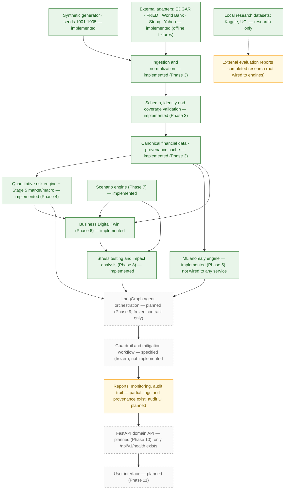

### 3.2 Diagram B — Deterministic engines versus LLM reasoning

Two separate responsibility paths. LLM output only affects the deterministic engines through the
validation gate; the LLM path itself is specified but **not deployed**.

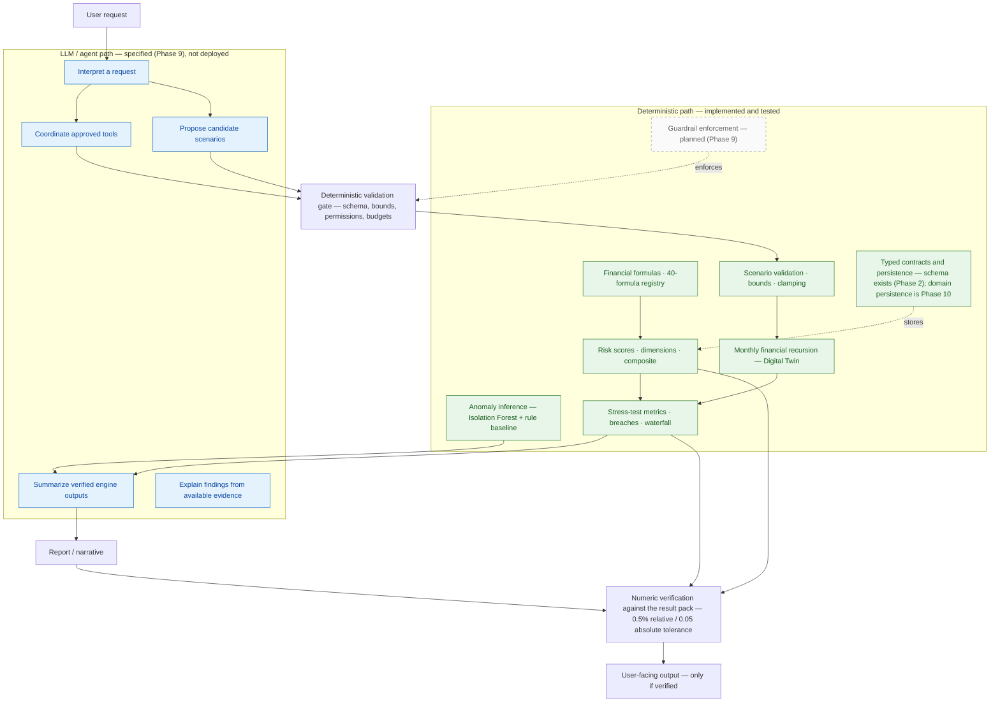

### 3.3 Diagram C — Phase 9 planned agent workflow

**Planned Phase 9 architecture — frozen design contract; orchestration not yet implemented.**
Source of truth: [docs/01_architecture/agents.md](docs/01_architecture/agents.md) (frozen at Phase 1).
No node below exists as running code.

```mermaid
flowchart TD
    START(("START")) --> VD["validate_data — deterministic, coverage gate"]
    VD --> SUP["supervisor — LLM, plans the agent sequence (max 2 planning rounds)"]
    SUP --> SP["specialists in plan order: financial · market · operational · macro (LLM)"]
    SP --> MLN["ml_anomaly — deterministic, skipped if include_ml = false"]
    MLN --> AGG["aggregator — deterministic, exact contribution decomposition"]
    AGG --> SG["supervisor_gate — LLM completeness check, at most 1 replan"]
    SG --> STN["scenario_translator — LLM, only if a scenario was requested"]
    STN --> GSB["guardrail_scenario_bounds — deterministic clamp or reject"]
    GSB --> INTR["interrupt: scenario_confirm — AI-translated scenarios only"]
    INTR --> STE["stress_engine — deterministic baseline + stressed runs"]
    STE --> MIT["mitigation — LLM, library-grounded candidates"]
    MIT --> REP2["report — LLM narrative over the result pack"]
    REP2 --> NV["numeric_verifier — deterministic, regenerate at most 2, else needs_review"]
    NV --> FIN["finalize — deterministic persist and terminal status"]
    FIN --> ENDN(("END"))

    classDef det fill:#e8f5e9,stroke:#2e7d32,color:#1b5e20
    classDef llm fill:#e3f2fd,stroke:#1565c0,color:#0d47a1
    class VD,MLN,AGG,GSB,STE,NV,FIN det
    class SUP,SP,SG,STN,MIT,REP2 llm
    classDef warn fill:#fff8e1,stroke:#f9a825,color:#7f6000
    class INTR warn
```

Frozen control rules shown above: replanning ≤ 1 loop; ≤ 6 tool calls per agent; 30 s per tool,
120 s per agent, `RUN_TIMEOUT_SECONDS` per run; per-run token budget; state persisted at node
boundaries; only one interrupt (`scenario_confirm`).

### 3.4 Diagram D — Data-to-decision lifecycle

How validated inputs become decisions (all boxes except mitigation/report/monitoring are implemented
today):

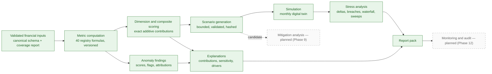

### 3.5 Diagram E — Phase and research roadmap

Completed engineering phases, the completed research track, and future integration milestones shown
separately (spec §36 numbering is authoritative):

```mermaid
flowchart LR
    subgraph ENG["Completed engineering (approval-gated)"]
        P0["Phase 0 · specification"] --> P1["Phase 1 · architecture freeze"] --> P2["Phase 2 · foundation"] --> P3["Phase 3 · data engineering"] --> P4["Phase 4 + Stage 5 · risk engine"] --> P5["Phase 5 · ML engine"] --> P6["Phase 6 · digital twin"] --> P7["Phase 7 · scenario engine"] --> P8["Phase 8 · stress testing"]
    end
    subgraph RES["Completed research track (separate from phases)"]
        R1["External Kaggle evaluation"]
        R2["Workstream A · ground-truth feasibility"]
        R3["Workstream C · threshold/seed stability"]
        R4["Workstream D · UCI supervised benchmark"]
        R5["Workstream E · provenance and licensing"]
        R6["Workstream F · independent twin/stress validation"]
    end
    subgraph FUT["Planned phases"]
        P9["Phase 9 · agent orchestration"] --> P10["Phase 10 · domain API"] --> P11["Phase 11 · frontend"] --> P12["Phase 12 · testing/observability/security"] --> P13["Phase 13 · evaluation benchmarks"] --> P14["Phase 14 · final documentation"]
    end

    P8 -.next milestone.-> P9

    classDef done fill:#e8f5e9,stroke:#2e7d32,color:#1b5e20
    classDef research fill:#e8eaf6,stroke:#3949ab,color:#1a237e
    classDef planned fill:#fafafa,stroke:#9e9e9e,stroke-dasharray:5 5,color:#616161
    class P0,P1,P2,P3,P4,P5,P6,P7,P8 done
    class R1,R2,R3,R4,R5,R6 research
    class P9,P10,P11,P12,P13,P14 planned
```

### 3.6 Frozen hard rules

| Rule | Statement |
|---|---|
| R1 | The LLM never performs arithmetic, risk calculation, simulation, database writes, or policy enforcement |
| R2 | Every LLM-emitted number is machine-verified against engine outputs before it reaches a user |
| R3 | Deterministic modules (`risk_engine`, `simulation`, `ml_engine`, `data_engine`) never import LLM/agent code — enforced by a test |
| R4 | The system is fully functional offline through the synthetic data path |
| R5 | Third-party data is cached locally with source/license/timestamp and never redistributed |
| R6 | Same inputs + seed ⇒ identical deterministic outputs (reproducibility) |
| R7 | The LLM provider is swappable via adapters (GLM-5.3-Flash is only the development default) |

R3 is not a slogan: `backend/tests/unit/test_architecture_imports.py` fails the build if a
deterministic module imports agent/LLM code.

---

---

## 4. Phase-by-Phase History (Phase 0 to Phase 9)

Phases are executed strictly one at a time; each ends with a report and an explicit approval gate
(spec §36). "Contract frozen" always means *documented and approved*, never *implemented*.

### Phase 0: Specification and Planning

| Field | Content |
|---|---|
| Purpose | Source-verified research and the master specification: what the system is, its constraints, its phase plan and its research questions |
| Key decisions | Locked decisions D1–D5: provider-agnostic LLM layer (GLM-5.3-Flash as dev default); hybrid data strategy (synthetic primary + macro/market/filing adapters); frontend stack deferred to Phase 11; focused ML scope (Isolation Forest + SHAP vs rule baseline); roadmap of 15 phases (0–14) with approval gates |
| Modules / files | `docs/master-project-specification.md`, `docs/00_research/phase-0-research.md`, `docs/development-log.md` (Phase 0 entry); four files created under phase control |
| Contracts / outputs | Scope (§12) and out-of-scope (§13), module map (§15–§16), engine specifications (§17–§24), evaluation plan (§26–§27), database/API design (§30–§31), phase table with exit criteria (§36), Definition of Done (§37) |
| Verification evidence | Documentation phase; research report records its sources and method; approval recorded in the development log |
| Dependencies | None — first phase |
| Known limitations | The specification is intent, not implementation; open questions were carried forward deliberately (for example the SHAP × IsolationForest spike, later resolved in Phase 5) |
| Status | ✅ Complete |

### Phase 1: Architecture and Contracts

| Field | Content |
|---|---|
| Purpose | Freeze every architectural contract before code exists, so later phases implement against fixed rules |
| Key decisions | Ten architecture documents created (three modified); hard rules R1–R7; testing policy (golden files regenerated only via `--regen-golden`, seeded property tests instead of Hypothesis); SQLite as the dev/test fallback |
| Modules / files | `docs/01_architecture/`: `project-overview.md`, `requirements.md`, `architecture.md`, `agents.md`, `data.md`, `risk-engine.md`, `simulation.md`, `api.md`, `database.md`, `testing.md` |
| Contracts / outputs | The **`RiskState`** run-state schema (24 typed fields), frozen graph topology, agent/tool/permission matrix; canonical financial data schema; formula-registry and scoring semantics; twin/scenario/stress equations; REST/SSE API specification; nine-table database schema; test strategy |
| Verification evidence | Contract review and approval gate recorded in `docs/development-log.md` (Phase 1 entry) |
| Dependencies | Phase 0 specification |
| Known limitations | **A frozen `RiskState` describes the intended graph state — it does not prove LangGraph is running.** None of these contracts is an implementation; every "planned" box in [§3](#3-architecture-and-visual-workflow) traces to them |
| Status | ✅ Complete |

### Phase 2: Foundation

| Field | Content |
|---|---|
| Purpose | Repository skeleton, configuration, logging, database foundation and the test harness everything else depends on |
| Key decisions | Explicit SQLAlchemy model classes (D1); request-scoped transactions (D2); `lru_cache` engines with test isolation (D3); hand-written migration `0001` mirrored by a column-agreement test (D4); structlog JSON to stdout (D5); Alembic URL resolution (D6); health route inside `create_app()` (D7); `analyses` table created early per frozen database spec (D8) |
| Modules / files | `backend/app/` (factory, logging, `api/deps.py`), `backend/core/` (`config.py`, `errors.py`), `backend/database/` (`session.py`, `models.py`, Alembic env + `migrations/versions/0001_core_tables.py`), `pyproject.toml`, `.env.example`, `Dockerfile`, `docker-compose.yml` |
| Contracts / outputs | Frozen settings contract, error envelope (api.md §1), nine tables, `/api/v1/health`, pytest/coverage/ruff/mypy configuration, `requirements-lock.txt` |
| Verification evidence | At closure: **23 passed**; Ruff clean; Mypy clean (21 files); Alembic upgrade → `0001` → downgrade → re-upgrade with 9 tables; uvicorn boot smoke returned the frozen health contract shape |
| Dependencies | Phase 1 contracts; Python 3.12 installed locally (frozen floor is 3.11) |
| Known limitations | Docker compose written but **never booted** (no Docker on the machine); no live PostgreSQL exercised (SQLite served all verification); benign framework deprecation warnings recorded in the report |
| Status | ✅ Complete |

### Phase 3: Data Engineering

| Field | Content |
|---|---|
| Purpose | A canonical, provenance-tracked data layer that works fully offline and can optionally ingest real sources |
| Key decisions | Synthetic-first (R4): deterministic generator produces five frozen-seed companies (seeds 1001–1005: manufacturing healthy/stressed, retail seasonal, services/SaaS stable, manufacturing concentrated with injected anomalies) across sectors, sizes, currencies (INR/USD/EUR), monthly or annual periods; external adapters are typed and return explicit success / degraded / unavailable — failure never fabricates a value; raw payloads are never committed (R5) |
| Modules / files | `backend/data_engine/`: `contracts.py`, `ingest/` (`synthetic.py`, `edgar.py`, `edgar_map.py`, `fred.py`, `world_bank.py`, `stooq.py`, `yahoo.py`), `normalize/` (`periods.py`, `currency.py`), `validate/` (`schema_checks.py`, `identities.py`), `cache.py`, `provenance.py`, `storage.py`, `features.py`, `risk_inputs.py`, `market_inputs.py`, `macro_inputs.py`; `scripts/generate_company.py`, `scripts/seed_db.py` |
| Contracts / outputs | Canonical financial schema with a 70% coverage gate and accounting-identity checks; period aggregation (sub-periods upward only) and currency normalization; offline cache with TTL, SHA-256 checksums and atomic writes; per-fetch provenance (source, endpoint, timestamp, license tag, checksum); idempotent storage |
| Verification evidence | At closure: **105 passed, 90% total coverage**; Ruff and Mypy clean (55 files); four fixture payloads (`fred_series.csv`, `world_bank.json`, `stooq.csv`, `edgar_companyfacts.json`); notebook `03_data_engineering/synthetic_data_profiling.ipynb` executed; no test touches the network |
| Dependencies | Phase 2 foundation |
| Known limitations | Adapters verified against fixtures, not live endpoints, during the phase; EDGAR is feature-flagged off by default (`ENABLE_EDGAR=0`); no annual→monthly decomposer exists (deferred as D-6-4, blocks real-filing use of the twin); synthetic realism is calibrated, not empirical |
| Status | ✅ Complete |

### Phase 4: Quantitative Risk Engine (with Stage 5)

| Field | Content |
|---|---|
| Purpose | Registry-driven, auditable computation of financial metrics into dimension and composite risk scores with exact explanations |
| Key decisions | 40 formulas with frozen anchors and edge cases, versioned (`registry_version` 1.0.0); piecewise-linear scoring with endpoint clamping (scores always 0–100); severity bands 0–25/25–50/50–75/75–100; configured vs effective weights exposed side by side; missing inputs reported as typed statuses (`MISSING_INPUT`, `INVALID_INPUT`, `UNAVAILABLE`, `INSUFFICIENT_HISTORY`) and never defaulted; Stage 5 decisions D18–D21 add separate equity/benchmark/FX legs (beta needs 120 aligned obs, VaR/ES 60, volatility 30; daily log returns; inner-date join; FX isolated to `fx_volatility`) and macro routing (CPI 24-month signed margin gap, FEDFUNDS 60-obs median, optional GDP volatility) |
| Modules / files | `backend/risk_engine/`: `registry.py`, `metrics/` (financial_strength, liquidity, credit, market, macro, operational, concentration), `scoring.py`, `sensitivity.py`, `engine.py`, `contracts.py`; Stage 5 inputs in `backend/data_engine/{market,macro,risk}_inputs.py` |
| Contracts / outputs | Metric → dimension → composite pipeline with **exact additive contributions reconciled at `abs_tol = 1e-9`** (the L1 explanation layer); ±20% weight sensitivity with Spearman rank stability; Altman Z/Z′/Z″ variant handling; Merton DD/PD reference-only and disabled; version stamped on every output |
| Verification evidence | At closure: **223 passed**; `risk_engine` coverage **94%**; registry coverage **40/40** hand-computed fixtures; golden profiles seeds 1001–1005 **5/5 byte-identical**; contribution reconciliation 5/5; Ruff/Mypy clean (83 files); both Phase 4 notebooks executed from fresh kernels. Audit corrections D2, D3, D9–D12 each asserted by a named test |
| Dependencies | Phases 1–3 |
| Known limitations | No validation against audited real statements or an external benchmark; market/macro metrics need caller-supplied cached series and degrade explicitly without them; recorded interpretations **Q-M1** (30-observation volatility floor), **Q-M2** (VaR/ES use the equity leg), **Q-C1** (signed inflation gap) remain open documentation-reconciliation items requiring approval to change |
| Status | ✅ Complete (Stage 5 approved) |

### Phase 5: ML Anomaly Engine

| Field | Content |
|---|---|
| Purpose | Answer "does this period look unusual relative to a baseline" — with a falsifiable evaluation protocol and no accuracy theater |
| Key decisions | Feature contract over lagged/rolling ratio changes; Isolation Forest as the one model (locked decision D4); a deterministic rolling z-score/IQR rule baseline as the retention gate; scores are a rank-CDF over the training batch (batch-dependent by design); anomaly scores are **not** mapped onto Phase 4 risk scores; attribution via `shap.Explainer` with a pre-authorized permutation fallback (spec risk register); seeded determinism with pinned-and-restored RNG |
| Modules / files | `backend/ml_engine/`: `features.py`, `models.py`, `baseline.py`, `train.py`, `evaluate.py`, `explain.py`, `contracts.py`; golden `backend/tests/golden/test_ml_goldens.py`; notebook `notebooks/05_ml_engine/01_ml_anomaly_validation.ipynb` |
| Contracts / outputs | `AnomalyResult` / `MLFinding` / `AnomalyExplanation` contracts; anomaly score + flag with thresholding; synthetic-injected evaluation (pinned fixture: 24 periods, 4 injected anomalies); driver attribution with the additivity contract `base_value + Σ values == decision_function(x)` within `1e-6`, else deterministic permutation fallback (seed 42, 5 rounds) |
| Verification evidence | At closure: **270 passed**; `ml_engine` coverage **99%** (503 statements); notebook executed fresh-kernel (24 cells, 0 errors); Ruff/Mypy clean (97 files); SHAP RNG defect found and fixed with a regression test |
| Dependencies | Phases 1–4 (feature inputs, contracts) |
| Known limitations | **The rule baseline beats the Isolation Forest on the pinned fixture (PR-AUC 0.8304 vs 0.5250)**, so the retention verdict is `baseline_wins_or_tie` and the model is not retained — intended falsifiability (D4), not a hidden failure. Metrics are **in-sample** on one synthetic company. The internal label `shap_exact` is a **misnomer**: with SHAP 0.52.0 the estimator resolves to `PermutationExplainer` (approximate; values vary ≈2.2e-4 between seeds — exact additivity is not exact attribution); renaming is deferred (D-1) because it would invalidate the golden fixture. Attribution is model-descriptive, never causal. No production entry point; no severity bands |
| Status | ✅ Complete (engine); model not retained on the pinned fixture |

### Phase 6: Business Digital Twin

| Field | Content |
|---|---|
| Purpose | Deterministic monthly financial recursion so scenarios and stress tests run on one auditable simulation path |
| Key decisions | Frozen equations implemented verbatim in equation order; all 18 parameters derived from a trailing 12-month window with every derivation and fallback recorded as a typed `AssumptionRecord`; horizon bounded 1..36 (default 12); nothing zero-filled/interpolated/forward-filled — missing inputs raise with the period named; six invariants computed from *emitted* months; Phase 4 ratio calculators reused unchanged (one documented substitution: monthly debt service in place of historical `st_debt`) |
| Modules / files | `backend/simulation/twin.py`, `assumptions.py`, `contracts.py`; golden `test_twin_goldens.py`; notebook `notebooks/06_digital_twin/01_digital_twin_validation.ipynb` |
| Contracts / outputs | `TwinResult` with monthly ledgers, trough/end-horizon KPIs (DSCR, interest coverage, cash runway), diagnostics (fallbacks used), provenance (`twin_version`, `registry_version`, seeds) and frozen disclaimers; invariants: cash identity (1e-6 relative), debt roll-forward, NWC continuity, non-negative tax, negative cash only via funding gap, bounded horizon |
| Verification evidence | At closure: **388 passed** (+118); `simulation` coverage 97–100%; golden trajectories seeds 1001–1005; notebook 27 cells, 0 errors; zero new dependencies; R3 imports hold |
| Dependencies | Phase 4 (ratio calculators), Phase 3 (canonical inputs) |
| Known limitations | **Honest finding 7.1:** a revenue *contraction* can raise trough cash (seed 1002, −30% revenue: min cash 14,107,653 → 19,533,795 while EBITDA falls) because shrinking releases working capital (`OCF = NI + DA − ΔNWC`) — economically coherent, pinned by test, recorded as **D-6-3** and *not* silently "fixed" (changing a frozen invariant needs change control). Annual/quarterly companies cannot be simulated (no annual→monthly decomposer; needs ≥12 monthly periods). No balance sheet (D-4). `base_rate` is a documented 6% offline default, disclosed per run; opex split frequently falls back to the frozen `F, v` form, also disclosed |
| Status | ✅ Complete |

### Phase 7: Scenario Engine

| Field | Content |
|---|---|
| Purpose | A bounded, validated, hashable scenario representation that an LLM may *propose* but never *enforce* |
| Key decisions | Decisions A–L implemented: single `SCENARIO_VERSION = "1.0.0"` scope (schema + bounds + presets); basis points normalized explicitly (200 bp → 2.0); ambiguous phrasing ("rates rise 2%") stays `awaiting_confirmation` with rate 0.0 instead of guessing; positive FX delta = depreciation; deltas are persistent monthly levels (no annualization); `ramp_months > horizon_months` rejected; confirmation re-validates; SHA-256 provenance hash; `one_off_cost` deliberately unbounded; no `backend/guardrails/` package (logic lives in the module) |
| Modules / files | `backend/simulation/scenarios.py` (+ property tests `test_scenario_properties.py`, unit tests `test_scenarios.py`); notebook `notebooks/07_scenario_engine/01_scenario_validation.ipynb` |
| Contracts / outputs | Frozen `ScenarioParams` schema with `extra="forbid"`; clamp-within-1.25×-then-reject bounds with machine-readable `ClampEvent`s (`scenario_bounds.<field>`); eight presets; `TranslationCandidate` → `validate_candidate` receiving dock for AI output (no LLM call inside the module); `confirm`/`cancel`; `to_overrides` normalization into twin fractions; `ScenarioProvenance` (origin, version, preset/source/model, hash) |
| Verification evidence | At closure: **444 passed** (56 new: 52 unit + 4 property); `scenarios.py` coverage **100%** (175 statements); Phase 4/5/6 goldens byte-identical; notebook 7 code cells, 0 errors; zero new dependencies |
| Dependencies | Phase 6 (override target), Phase 1 (frozen scenario schema) |
| Known limitations | Validation only — computes no financial outcome; `one_off_cost` accepts absurd values by design; no timestamps in deterministic output (R6); currency binds at run time; live NL translation is Phase 9 |
| Status | ✅ Complete |

### Phase 8: Stress Testing and Impact Analysis

| Field | Content |
|---|---|
| Purpose | Baseline-vs-stressed execution with KPI comparison, breach detection, an EBITDA waterfall and sensitivity sweeps — all on one deterministic path |
| Key decisions | Decisions A–L implemented: `STRESS_VERSION = "1.0.0"`; both runs via `simulate()` (zero overrides vs validated overrides), refusal if either run's invariants fail; scenario horizon *is* the execution horizon; undefined Δ% returned as `None` **with a reason**; breach output is status/records only (no severity labels); frozen listing orders asserted in tests; 9-point inclusive sweeps ∪ baseline, ≤10 runs, OFAT only; `result_hash` = SHA-256 over canonical JSON; no `backend/guardrails/` package |
| Modules / files | `backend/simulation/stress.py`, `backend/simulation/sensitivity.py`; goldens `stress_seed_1001..1005.json` (version-gated); tests `test_stress_a/b/c.py`, `test_stress_properties.py`, `test_stress_goldens.py`; notebook `notebooks/08_stress_testing/01_stress_validation.ipynb` |
| Contracts / outputs | `StressTestResult` (KPI rows at trough/end-horizon in frozen order, Δ absolute/Δ %, breach records with defaults runway 6.0 / DSCR 1.2 / coverage 1.5, four-bucket EBITDA waterfall + below-EBITDA interest/tax bridge at 0.5% closure); `SensitivityResult` (nine sweepable bounded fields, breach onset); refusal semantics; invariants and diagnostics |
| Verification evidence | At closure: **498 passed**; `stress.py` and `sensitivity.py` coverage **97%** each; Phase 4/5/6 goldens byte-identical; notebook 17 cells, 0 errors with hand-check residual 0.000e+00; determinism (byte-identical reruns + `result_hash` equality) asserted; R3 holds; zero new dependencies |
| Dependencies | Phases 4–7 |
| Known limitations | **Blocker B1:** the current-ratio breach rule is permanently `unevaluable` (the twin emits AR/Inv/AP flows, not current-asset/liability levels; inventing a proxy would be new methodology) — consumers must not read `unevaluable` as "healthy". **B2:** per-dimension risk deltas deferred (D-6-7). Custom breach policies are per-call only, never persisted. Sweeps are global-range OFAT and do not measure interactions. **Capacity-ceiling saturation:** on a fully capacity-capped company (seed 1001), positive revenue shocks change nothing — frozen twin behavior, surfaced and pinned rather than hidden. D-6-3 remains deferred to change control. Synthetic-only validation |
| Status | ✅ Complete |

### Phase 9: Multi-Agent Orchestration

| Field | Content |
|---|---|
| Purpose | Connect the deterministic engines to an LLM-orchestrated workflow under guardrails |
| Current status | **Frozen design contract; implementation not started.** Evidence: [docs/01_architecture/agents.md](docs/01_architecture/agents.md) is marked "Frozen at Phase 1"; there is no `backend/agents/` package, zero `langgraph` references in code and no `langgraph` dependency in `pyproject.toml`/`requirements-lock.txt` |
| Key design decisions (frozen) | `RiskState`: 24 typed fields (`run_id` … `status`), optional-until-filled, persisted at node boundaries; topology `validate_data → supervisor → specialists (plan order) → ml_anomaly → aggregator → supervisor_gate → scenario_translator → guardrail_scenario_bounds → interrupt(scenario_confirm) → stress_engine → mitigation → report → numeric_verifier → finalize`; eight LLM agents (supervisor, financial, market, operational, macro, scenario_translator, mitigation, report) plus deterministic aggregator / numeric_verifier / finalize; 15 tools behind a permission matrix (anything unlisted is denied and logged as `guardrail_events`); structured steps at temperature 0, narrative ≤ 0.3; retries 2× with backoff; numeric verification tolerance 0.5% relative / 0.05 absolute, regenerate ≤ 2 then terminal `needs_review`; degraded modes keep deterministic output flowing when the LLM is unavailable |
| Modules / files | **None yet.** Planned under spec §36: state, graph, supervisor, specialists, tools, prompts, guardrail wiring, LLM adapters |
| Verification evidence | None for implementation; the contract itself is under configuration control in `docs/01_architecture/` |
| Dependencies | Phases 0–8 (engines to call), provider-agnostic LLM adapter (D1/R7), recorded/mock-LLM test harness |
| Acceptance criteria (spec §36 + contracts) | Agent integration tests with recorded/mock LLM **plus** a live smoke test; approval gate; typed state-transition tests; permission-matrix tests; numeric-verifier mismatch tests; budget/timeout enforcement; trace persistence |
| Known limitations | Documentation existence is not implementation; nothing in this README may read as "agents are running" |
| Status | ⏳ Planned — next milestone |

---

## 5. Completed Research and External Workstreams

The external-evaluation program is a **separate research track**: committed studies that assess the
platform's *methods* against external data. They change no frozen contract, add no model to the
product, and are **not wired into any engine, API or agent**. Each study's own report is the authority
for its numbers and caveats. A study is complete even when its result is negative or inconclusive.

### Model and architecture status (research versus product)

| Component | Status |
|---|---|
| Isolation Forest (`backend/ml_engine/`) | **Implemented** — the core ML anomaly detector (Phase 5) |
| Rolling z-score/IQR rule baseline | **Implemented** — deterministic baseline (Phase 5) |
| DummyClassifier, Logistic Regression, Random Forest, HistGradientBoosting | **Benchmark-only** — evaluated solely inside the UCI study; **not** part of any product engine |
| Explainability | Permutation-family Shapley estimator (`shap.Explainer` → `PermutationExplainer` at SHAP 0.52.0) — descriptive attribution of the model, **not causal** |
| LangGraph multi-agent orchestration (Phase 9) | **Planned, not implemented** |
| FastAPI | App factory + `/api/v1/health` only — no domain API, no frontend integration |

### Workstream A: Ground-truth recovery feasibility

**Question:** can genuine outcome labels be recovered for the anonymized Kaggle `Bankruptcy.csv`
rows (`Attr1`–`Attr64`), so that supervised metrics become possible?

**Sources investigated:** public label archives and registries; content matching against upstream
copies (the 5,000 rows are content-identical to an upstream *test* file under different header
aliases, but that file carries no labels either); a labeled candidate overlapped on only **55 of
5,000 rows** — not enough to label this file even in principle; Kaggle-side sources were blocked by
missing credentials.

**Conclusion:** **no labels were obtained and no data was downloaded.** The anonymized rows cannot be
reliably relinked to companies or outcomes; supervised bankruptcy precision/recall/F1/AUC for this
dataset remain impossible from repository evidence. **What remains unknown:** the true class
membership of these rows.

→ [docs/external-evaluation/ground-truth-feasibility.md](docs/external-evaluation/ground-truth-feasibility.md)
(future work recommends UCI 572 as a separate labeled benchmark — later done as Workstream D)


### Workstream C: Anomaly stability and threshold sensitivity

**Question:** are the frozen Isolation Forest's scores and flags robust to the choices an analyst
makes — the operating threshold and the random seed?

**What was varied / what stayed frozen:** the *operating rate* was swept from 0.02 to 0.30 over one
frozen seed-42 ranking (the flag sets are **nested by construction** — a higher rate never means
"better detection"), and the *training seed* was varied (43, 44, 45, …) with the pipeline otherwise
frozen.

**Findings:** the flagged count is fixed by the train-quantile threshold (834 of 5,000 at rate
0.1668; 27 of 160 at 0.16875); the global ranking is stable — Spearman ρ ≈ **0.96–0.97** (Bankruptcy)
and ≈ **0.98** (Financial Statements) against the seed-42 reference — while **exact top-k membership
churns** (top-set Jaccard stays well below 1).

**Interpretation:** stability shows the ranking is not a seed accident. It does **not** prove
predictive accuracy — there are still no labels to be accurate against. Figures:
[threshold sensitivity and seed/rank stability](#83-threshold-and-seed-stability).

→ [docs/external-evaluation/anomaly-stability-analysis.md](docs/external-evaluation/anomaly-stability-analysis.md)

### Workstream D: UCI supervised bankruptcy benchmark

**Question:** how well do standard classifiers rank Taiwanese bankruptcy risk on a genuinely labeled
external dataset — as an *independent benchmark*, separate from the product?

**Dataset and protocol:** UCI 572 (CC BY 4.0; details in
[§6.4](#64-uci-taiwanese-bankruptcy-prediction-labeled-benchmark)); fixed seed 42, stratified 80/20
fixed seed 42, stratified 80/20 (train 5,455 / test 1,364; positives 176 / 44); F1-optimal threshold
chosen by 5-fold out-of-fold CV **inside the training partition only**; the test partition is touched
once; scaling fits inside pipeline folds; the target is never used as a feature.

**Results (measured, held-out test):** full table in [§7.2](#72-external-supervised-benchmark-uci) —
HistGradientBoosting leads with **AP 0.5238 / ROC-AUC 0.9540** against a no-skill AP baseline of
**0.03226**; DummyClassifier sits exactly at no-skill (0.0320 / 0.4939).

**Limitations:** a single random split — no temporal validation, no forecast horizon, no company IDs
or dates (entity/temporal leakage cannot be excluded); class imbalance (3.23% positive) makes AP the
primary metric; these models are **not** integrated anywhere in the product.

Reproduce: `python -m backend.external_data.uci_benchmark` →
`data/processed/uci-bankruptcy/benchmark_results.json`.

→ [Plan](docs/external-evaluation/uci-bankruptcy-benchmark-plan.md) ·
[Report](docs/external-evaluation/uci-bankruptcy-benchmark-report.md)

### Workstream E: Dataset provenance and licensing

**Question:** what do we actually know about where the external datasets came from and whether reuse
is permitted?

**Findings:** the audit separates three facts that are often conflated — **where a copy was
downloaded**, **who originally published the data**, and **which license governs reuse**. Both Kaggle
datasets are rated **LICENSING_RESTRICTED / UNVERIFIED** (download location observed; original source
and license not established to the standard the audit sets), and neither is redistributed by this
repository — `data/raw/` is git-ignored by policy (R5). An identical copy found elsewhere does **not**
by itself establish provenance or permission. Nothing in the audit is legal advice.

**Status:** the caveat stays explicit wherever these datasets are discussed. The UCI dataset, by
contrast, has a verified CC BY 4.0 license and DOI.

→ [docs/external-evaluation/dataset-provenance-and-licensing.md](docs/external-evaluation/dataset-provenance-and-licensing.md)

### Workstream F: Independent Digital Twin and stress validation

**What this is:** a read-only audit of the frozen Phase 6–8 engines along two explicitly separated
axes — does the code implement its documented contract, and are outputs financially coherent under
the stated assumptions. Four additive tests were added; no frozen code or golden was modified.

**Independent checks and results:** expected values G1–G4 were derived **by hand from the frozen
formulas with round inputs**, not read from engine output (missing-input refusal; DSCR/coverage
sentinels 999.0, real negative branches; waterfall bucket sums and the 0.5% four-bucket closure;
interest/principal/DSCR arithmetic) — all reproduced. Existing invariants, the missing-input guard
and the full waterfall decomposition were confirmed correct.

**D-6-3 (working-capital release) disclosed accurately:** under a revenue contraction, receivables
and inventory shrink and release cash (`OCF = NI + DA − ΔNWC`), so **trough cash can rise while
EBITDA falls**. The engine behaves per its frozen equations; the *naive monotonicity invariant* in
the frozen spec (§6.3) is the incorrect part. It is **resolved-as-documented** — pinned by golden and
unit tests, not silently "fixed", and changing it requires change control.

**Known exceptions left open:** dimension deltas and the current-ratio proxy remain `unevaluable`
(D-6-7 / B1 — the twin projects no balance-sheet levels); simplified tax, interest accrual and
financing-order conventions are modelling simplifications, not a full accounting system.

**Not established:** empirical real-world validity — the twin runs on synthetic data; no validation
set exists. Reproduce: `python -m pytest backend/tests/unit/test_twin_stress_independent.py -v`.

→ [docs/external-evaluation/digital-twin-stress-validation-report.md](docs/external-evaluation/digital-twin-stress-validation-report.md)

### The original external Kaggle evaluation (program starting point)

The first external-dataset experiment (2026-10-10) ran the frozen Phase 5 pipeline — preprocessing →
Isolation Forest + rule baseline → risk-engine mapping → explainability → figures — on the two
unlabeled Kaggle datasets. Its **corrected conclusions**, restated in
[§8](#8-exact-external-evaluation-findings): flag rates are operating points, not prevalence;
supervised metrics are impossible without labels; the rolling-baseline numbers first reported pooled
across companies (104/161) were **superseded** by the correct per-company, past-only computation
(60 of 64 scorable rows); risk-metric coverage on Financial Statements is 15 of 38 with liquidity
0 of 12 — no score was ever fabricated.

→ [docs/external-evaluation/external-financial-dataset-evaluation.md](docs/external-evaluation/external-financial-dataset-evaluation.md)

---

## 6. Dataset Inventory

Local **raw** data lives under `data/raw/` and is **git-ignored by policy** (rule R5: third-party
payloads are never committed or redistributed). What Git tracks are the deterministic derivatives:
22 processed JSON records under `data/processed/` (including `uci-bankruptcy/benchmark_results.json`
and the stability records) plus the 19 figures under `docs/assets/external-evaluation/`.

| Dataset | Source | Shape | Labels | Granularity | Raw local path (git-ignored) | Tracked derivatives | Used by |
|---|---|---|---|---|---|---|---|
| Internal synthetic validation data | Deterministic generator (this repo) | 5 seeded companies (1001–1005), multi-year | Injected anomaly flags (by construction) | Monthly or annual | `data/synthetic/` (ignored, regenerable) | Golden fixtures in `backend/tests/golden/` | Phases 3–8 engineering, all tests |
| Kaggle `Bankruptcy.csv` | Kaggle (provenance UNVERIFIED) | 5,000 × 65 (`ID` + `Attr1`–`Attr64`) | **None** (no `Class` column) | One row per company | `data/raw/kaggle/bankruptcy/Bankruptcy.csv` | 8 JSON run records under `data/processed/kaggle/bankruptcy/` | Unsupervised anomaly evaluation (research) |
| Kaggle `Financial Statements.csv` | Kaggle (provenance UNVERIFIED) | 161 × 23, 12 companies, 2009–2023 | None | **Annual** | `data/raw/kaggle/financial statements/Financial Statements.csv` (space in folder name) | 10 JSON records under `data/processed/kaggle/financial-statements/` + run summary | Unsupervised anomaly + risk-metric mapping (research) |
| UCI Taiwanese Bankruptcy Prediction | UCI ML Repository id 572, DOI 10.24432/C5004D, CC BY 4.0 | 6,819 × 96 (95 features + `Bankrupt?`) | 220 positives (3.2263%) | Firm/year rows, no dates in file | `data/raw/uci/taiwanese-bankruptcy-prediction.zip` and `data/raw/uci/data.csv` | `data/processed/uci-bankruptcy/benchmark_results.json` | Supervised benchmark (research, benchmark-only) |

### 6.1 Internal synthetic validation data

The backbone of every deterministic claim in this repository: a seeded generator
(`backend/data_engine/ingest/synthetic.py`, CLI `scripts/generate_company.py`) produces five frozen
profiles — seeds 1001–1005 (manufacturing healthy/stressed, retail seasonal, services/SaaS stable,
manufacturing concentrated **with injected anomalies**) across sectors, sizes, INR/USD/EUR currencies
and monthly or annual periods, with seasonality, growth drift, debt schedules and concentration
buckets. Golden fixtures pin their trajectories byte-for-byte (`backend/tests/golden/`).

**This is synthetic validation by construction** — it proves determinism, invariants and correctness
of implementation, and it lets anomaly detection be scored against known injected events. It is
**not** real-world validation and no claim in this README treats it as such.

### 6.2 Kaggle Bankruptcy.csv (unsupervised, unlabeled)

| Aspect | Verified fact |
|---|---|
| Shape | **5,000 rows × 65 columns**: one integral unique `ID` plus anonymized `Attr1`–`Attr64`; 0 duplicates, no constant columns |
| Labels | **No `Class`/outcome column exists.** Supervised precision, recall, F1, ROC-AUC, PR-AUC, accuracy and a confusion matrix are **impossible** without genuine labels (Workstream A: none recoverable) |
| Granularity | One row per (anonymized) company; no dates, no sectors, no currency metadata |
| Preprocessing | Finite-value audit and complete-case/feature matrix per the frozen contract; no imputation |
| Engines/models applied | Frozen Phase 5 Isolation Forest + rolling z-score/IQR baseline; risk-registry mapping attempted (see [§8.4](#84-risk-metric-coverage) — anonymized ratios lack sufficient semantics for reliable mapping) |
| Actual results | 834 of 5,000 flagged at the frozen operating point (16.68% — a threshold choice, **not** measured bankruptcy prevalence); rank stability ρ ≈ 0.96–0.97 across seeds |
| Source comparison | A prior check established **row-content equality of all 5,000 data rows** with an upstream test file under different header aliases. This is *not* a claim that two whole files are byte-identical or hash-identical |
| License/provenance | **LICENSING_RESTRICTED / UNVERIFIED** (Workstream E); never redistributed (`data/raw/` ignored) |
| Local path | `data/raw/kaggle/bankruptcy/Bankruptcy.csv` (git-ignored — obtain separately; not committed) |
| Derived artifacts | `data/processed/kaggle/bankruptcy/*.json` (audit, preprocessing, anomaly_run, evaluation, explanations, leakage, provenance, rule_baseline) — tracked; figures in `docs/assets/external-evaluation/bankruptcy/` — tracked |

### 6.3 Kaggle Financial Statements.csv (annual, unlabeled)

| Aspect | Verified fact |
|---|---|
| Shape | **161 source rows × 23 columns**: Year, Company, Category + 20 numeric fields; **12 companies** (AAPL, AIG, AMZN, BCS, GOOG, INTC, MCD, MSFT, NVDA, PCG, PYPL, SHLDQ) |
| Periods | **Annual observations spanning 2009–2023** (9–15 obs/company; 10 of 12 companies have ≥ 12 periods). **These are real annual rows — not fabricated monthly data**, and the Digital Twin (monthly-only) was **not** validated on them |
| Missingness | **One missing `Market Cap(in B USD)` entry** → dropped by the frozen complete-case contract (161 → **160 modeling rows**); no imputation |
| Labels | None |
| Engines/models applied | Frozen Isolation Forest + rolling baseline (per-company, ascending-year, past-only windows, `min_periods = 8`); risk-engine registry mapping (15 of 38 metrics computable, **liquidity 0 of 12** — scores are `None`, never fabricated) |
| Actual results | 27 of 160 modeling rows flagged (16.875% operating point); rolling baseline flagged 60 of 64 scorable periods with **96 unscorable** rows (short within-company history; PYPL contributes 0 scorable rows) — 96/160 excluded with a documented reason, and 0.9375 is the baseline's behavior on the scorable subset, **not** verified anomaly prevalence |
| Interpretation caveats | Partial metric coverage (15/38) can produce misleading or incomplete composites — the report discloses per-metric availability; a Microsoft FY2023 spot-check matched an SEC 10-K, which does **not** mean every row was independently verified against SEC filings |
| License/provenance | **LICENSING_RESTRICTED / UNVERIFIED** with unresolved attribution caveats (Workstream E) |
| Local path | `data/raw/kaggle/financial statements/Financial Statements.csv` — **note the space in `financial statements`** (git-ignored) |
| Derived artifacts | `data/processed/kaggle/financial-statements/*.json` (audit, panel, risk_mapping, …) and `data/processed/kaggle/run_summary.json` — tracked; figures in `docs/assets/external-evaluation/financial-statements/` — tracked |

### 6.4 UCI Taiwanese Bankruptcy Prediction (labeled benchmark)

| Aspect | Verified fact |
|---|---|
| Source | UCI ML Repository **dataset id 572**, **DOI 10.24432/C5004D**, **license CC BY 4.0** (verified on the official page); Taiwan Economic Journal, 1999–2009 |
| Shape | **6,819 rows × 96 columns** = 95 features + target `Bankrupt?`; audit found 0 duplicate rows, 0 missing cells, 0 non-finite values, and **1 constant feature (` Net Income Flag`)** |
| Labels | 220 positives — **3.2263% prevalence** (class imbalance is why AP is the primary metric) |
| Split (fixed) | Seed **42**, stratified 80/20: **train 5,455 rows (176 positive) · test 1,364 rows (44 positive)**; prevalence preserved (0.0323 each) |
| Role | A **supervised classification benchmark, separate from the unlabelled Kaggle `Bankruptcy.csv`** — different provenance, no shared companies, rows or identities; it never touches the Kaggle files |
| Integrity | Raw SHA-256 hashes pinned in the report; `data/raw/uci/` is git-ignored; only `benchmark_results.json` is tracked |
| What it does **not** establish | Temporal prediction, forecast-horizon validity, entity-level leakage freedom (no company IDs/dates), or production generalization |

### 6.5 Other data sources (adapters, not benchmark inputs)

Verified implemented connectors in `backend/data_engine/ingest/` — **all offline-tested against
committed fixture payloads**; none was live-verified during the external research, and none fed the
Kaggle/UCI benchmarks:

| Adapter | Module | Role | Default state |
|---|---|---|---|
| Synthetic generator | `synthetic.py` | Primary canonical path (R4) | On |
| SEC EDGAR | `edgar.py`, `edgar_map.py` | Real-filing ingestion, annual/quarterly | Feature-flagged **off** (`ENABLE_EDGAR=0`) |
| FRED | `fred.py` | Macro series (CPI, FEDFUNDS) | Key via env; offline cache first |
| World Bank | `world_bank.py` | Macro series | Offline cache first |
| Stooq | `stooq.py` | Market prices — terms-flagged primary | Cache-first, throttled |
| Yahoo (yfinance) | `yahoo.py` | Market fallback | Optional extra (`pip install -e ".[market]"`) |

Separate from the product data layer, `backend/external_data/` holds the **research-only** loaders for
the two Kaggle datasets and UCI. **Implemented connectors · locally stored research datasets ·
synthetic fixtures · planned live integrations** are four different things; only the first three
exist today.

---

## 7. Model Inventory and Evaluation Results

### 7.1 Core ML anomaly engine (product code path)

| Element | What it is |
|---|---|
| Isolation Forest | The one product anomaly model (locked decision D4), seeded, over engineered ratio-change features |
| Rolling z-score/IQR rule | Deterministic baseline; also the retention gate |
| Feature construction | Lagged/rolling ratio changes per the frozen feature contract; no lookahead by construction |
| Evaluation | Synthetic injected anomalies on the pinned fixture — **in-sample**, descriptive of that fixture |
| Explanation | Permutation-family Shapley attribution with additivity check + deterministic permutation fallback (seed 42, 5 rounds) |
| Semantics | Scores answer *"does this period look unusual relative to the chosen baseline"* — an anomaly score is **not** a probability of bankruptcy and not a Phase 4 risk score |

Honest outcome: on the pinned fixture the **rule baseline beats the model (PR-AUC 0.8304 vs 0.5250)**,
retention verdict `baseline_wins_or_tie` — the model is not retained. See
[Phase 5](#phase-5-ml-anomaly-engine).

### 7.2 External supervised benchmark (UCI)

Four classifiers were evaluated on the labelled UCI data (benchmark-only — none is part of the
product). Held-out test values below match the committed
[report](docs/external-evaluation/uci-bankruptcy-benchmark-report.md) and
[`benchmark_results.json`](data/processed/uci-bankruptcy/benchmark_results.json):

| Model | Average Precision | ROC-AUC |
|---|---:|---:|
| DummyClassifier (stratified) | 0.0320 | 0.4939 |
| Logistic Regression | 0.3190 | 0.9171 |
| Random Forest | 0.4955 | 0.9528 |
| HistGradientBoosting | **0.5238** | **0.9540** |

No-skill average-precision baseline ≈ **0.03226** (= prevalence).

How to read these numbers:

- **Class imbalance:** 3.2263% positive — AP is primary; ROC-AUC flatters under imbalance (the dummy
  sits at ~0.5 ROC-AUC while its AP equals prevalence).
- **Split:** fixed-seed (42) *stratified random* 80/20 — **not** temporal validation; the dataset has
  no dates or company IDs, so there is no established forecast horizon and entity/temporal leakage
  cannot be fully excluded.
- **Threshold selection:** the F1-optimal threshold comes from 5-fold out-of-fold predictions
  **inside the training partition only**; the test partition is evaluated once.
- **Scope:** single-split benchmark numbers for this dataset only. They do **not** transfer to live
  companies, to the Kaggle data, or to the product's anomaly engine — these models exist solely in
  `backend/external_data/uci_benchmark.py`.

### 7.3 Explainability

The core pathway (`backend/ml_engine/explain.py`) constructs `shap.Explainer` over the Isolation
Forest `decision_function` with an independent masker (background ≤ 50 rows, seed 42). **At SHAP
0.52.0 this resolves to `PermutationExplainer`** — a Monte-Carlo permutation-family Shapley
estimator — not TreeSHAP (TreeSHAP structurally violates the engine's additivity contract against
`decision_function`; measured additivity error ≈ 4.50 vs tolerance 1e-6, per the Phase 5 report).
Rows that fail the additivity check (or raise) fall back to deterministic permutation importance
(`default_rng(42)`, 5 rounds).

- **What the attribution represents:** how much each feature moved *this model's* score for *this
  row*, relative to a background sample. Useful for triage and for auditing model behavior.
- **Why it is not causal:** it describes the model, not the business; the contract carries an explicit
  causality disclaimer (`CAUSALITY_DISCLAIMER`).
- **Approximation limits:** values vary ≈2.2e-4 between sampling seeds; additivity is exact (the
  estimator enforces the efficiency constraint) but *exact additivity is not exact attribution*.
- **Naming mismatch (recorded):** the frozen interface label is `shap_exact` and the golden fixture
  pins it, although the estimator is approximate. Renaming would invalidate the golden and is a
  semantic change requiring separate approval (deferred item D-1) — the mismatch is documented in the
  Phase 5 report §11.5 rather than hidden.

---

## 8. Exact External Evaluation Findings

Every number here was checked against the committed reports on 2026-10-11. Research evidence, not
product claims; each study's report remains authoritative.

### 8.1 Bankruptcy anomaly results

Isolation Forest on `Bankruptcy.csv` (5,000 × 64 feature matrix) flagged **834 of 5,000 rows —
flag rate 16.68%**. This is a **threshold-defined operating rate** (train-quantile alert budget),
**not** measured real-world bankruptcy prevalence, and a higher flag rate never means better
detection.

### 8.2 Financial Statements anomaly results

Isolation Forest flagged **27 of 160 modeling rows — 16.875%**. The rolling statistical baseline,
applied per company on ascending-year, past-only windows (`min_periods = 8`): **60 flagged of 64
scorable periods**, with **96 unscorable periods** (within-company history too short; PYPL has zero
scorable rows). Do **not** read 93.75% as verified anomaly prevalence — it describes the baseline's
behavior on the scorable subset only. Earlier pooled numbers (104/161) that crossed company
boundaries are superseded.

### 8.3 Threshold and seed stability

Two headline figures from Workstream C (both generated deterministically from frozen seed-42 runs):

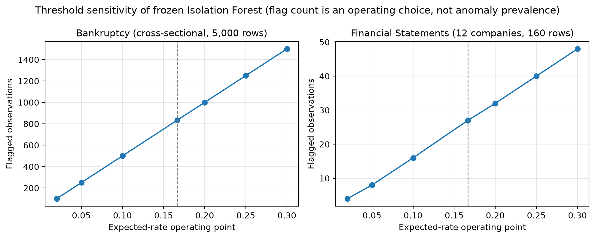

*Threshold sensitivity — flagged count as the operating rate sweeps 0.02–0.30 on one frozen seed-42
ranking; the flag sets are **nested by construction**, so the curve is an alert-budget choice, not a
detection-quality curve. Source: [stability analysis §2](docs/external-evaluation/anomaly-stability-analysis.md).*

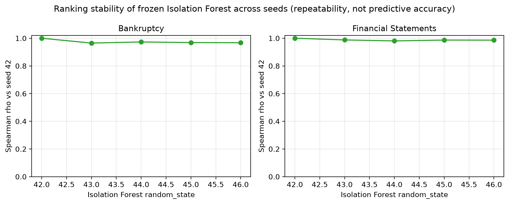

*Seed/rank stability — Spearman rank correlation of anomaly scores against the seed-42 reference
(ρ ≈ 0.96–0.97 on Bankruptcy, ≈ 0.98 on Financial Statements) while exact top-k membership churns.
Source: [stability analysis §3](docs/external-evaluation/anomaly-stability-analysis.md).*

**What was varied:** operating rate (0.02–0.30) and training seed (42 vs 43+). **What stayed frozen:**
pipeline, preprocessing, threshold policy (train quantile), datasets. **Caveat:** stable scores show
rank robustness only — with no labels, stability cannot and does not prove predictive accuracy.

### 8.4 Risk-metric coverage

| Dataset | Registry coverage | Detail |
|---|---|---|
| Financial Statements | **15 of 38** metrics computable · **23 missing** required inputs | **Liquidity: 0 of 12** — current assets/liabilities are absent, so the dimension returns `None`; no score was fabricated. Partial coverage can make composites misleading; the report discloses per-metric availability |
| Bankruptcy.csv | **Not reliably mappable** | The anonymized `Attr1`–`Attr64` ratios lack sufficient semantics for reliable mapping into the financial risk registry — **no full financial risk grades were obtained** for this dataset |

### 8.5 Digital Twin validation

The independent [Workstream F report](docs/external-evaluation/digital-twin-stress-validation-report.md)
confirms contract implementation and financial coherence (hand-derived G1–G4 expectations all pass;
waterfall closure within 0.5%; missing-input guards correct). The **documented monotonicity issue
stands as disclosed:** a contraction shock releases working capital and can raise trough cash while
EBITDA falls (seed 1002, −30% revenue: min cash 14,107,653 → 19,533,795). The frozen spec's naive
§6.3 monotonicity invariant is the incorrect part, not the engine; it is **resolved-as-documented**
(pinned by tests, change control required to alter) — not silently fixed, and **not** a claim that
every stress invariant passed as originally worded. Empirical real-world validity is explicitly
**not** established: synthetic data only.

### 8.6 Data and provenance

See [Workstream E](#workstream-e-dataset-provenance-and-licensing): download location, original
publisher and legal license are separated; both Kaggle datasets remain
**LICENSING_RESTRICTED / UNVERIFIED** with unresolved caveats — no source is described as
"verified licensed" where the report says applicability remains uncertain. Raw third-party files are
never committed or redistributed (R5); UCI's CC BY 4.0 + DOI are the one verified license
combination.

---

## 9. Visualization Gallery

Curated views from the 19 committed charts (full index with per-figure caveats:
[docs/assets/external-evaluation/README.md](docs/assets/external-evaluation/README.md)). All figures
are generated deterministically (Agg backend, DPI 200); label-gated chart slots (PR curves, confusion
matrices, model comparisons) render honest *"unavailable — no labels"* notices instead of invented
curves. The two stability charts are embedded in [§8.3](#83-threshold-and-seed-stability); the eight
charts below complete the curated set.

**Bankruptcy dataset (unlabeled):**

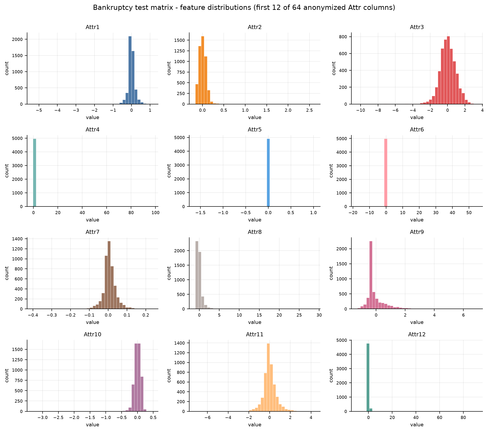

*Feature distributions — 12-panel histograms of `Attr1`–`Attr12`; the columns are anonymized, so
these show shape only, with no financial meaning attachable. Caveat: semantics unknown by design.*

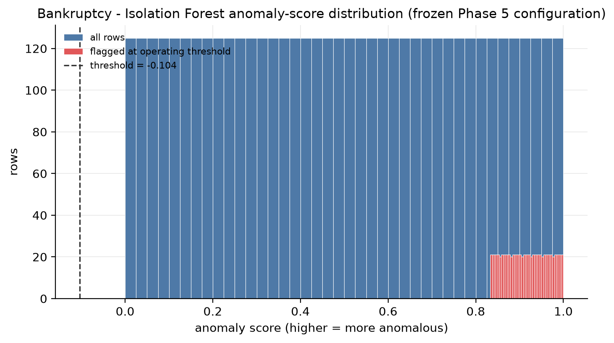

*Anomaly-score distribution — frozen Phase 5 scores with the operating threshold and flagged overlay
(834 of 5,000). Caveat: the flagged share is a threshold choice, not measured prevalence.*

**Financial Statements dataset (annual, unlabeled):**

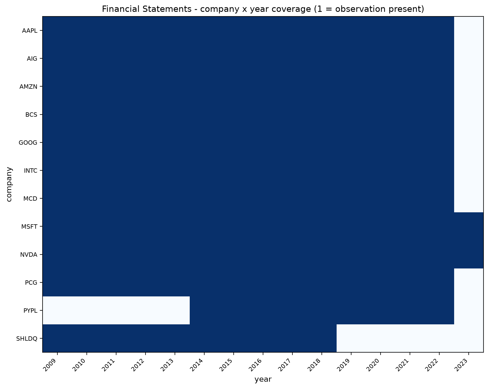

*Dataset overview — company × year coverage heatmap (161 rows, 12 companies, 2009–2023). Caveat:
annual data; the monthly-only Digital Twin was not run on it.*

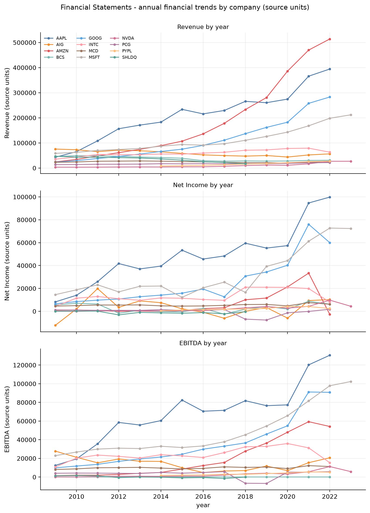

*Financial trends — Revenue / Net Income / EBITDA by company in source units; ten of twelve companies
have at least 12 periods.*

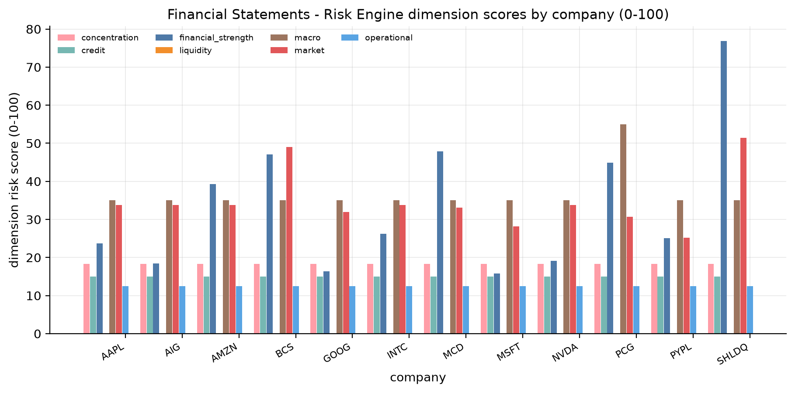

*Risk-dimension distribution — Phase 4 dimension scores per company (0–100, `None` = unavailable).
Caveat: only 15 of 38 metrics computable; liquidity is `None` for every company — never read missing
as healthy.*

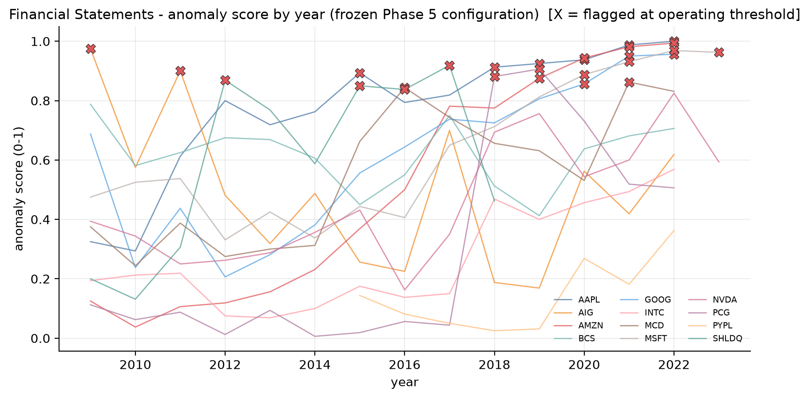

*Anomaly results — score vs. year with 27 flagged rows marked; short per-company histories leave 96
rows unscorable for the rolling baseline.*

**Cross-dataset comparisons:**

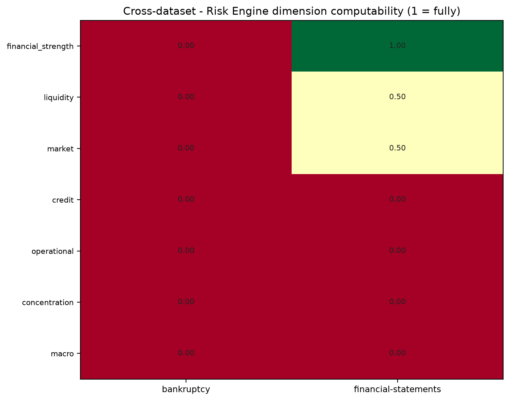

*Risk-dimension computability — which dimensions can be scored on each dataset (per-column
availability). This is the honest picture behind the 15-of-38 coverage claim.*

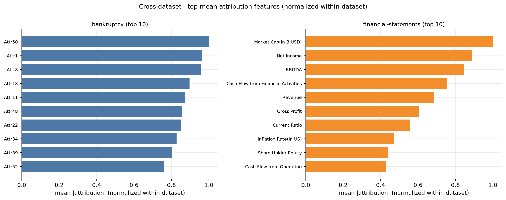

*Feature-importance comparison — top mean |attribution| features per dataset (normalized within
panel). Caveat: model-descriptive attribution, not causal drivers, and not comparable to supervised
feature importance.*

> **No UCI figures exist** — the supervised benchmark is tabular evidence only (report tables +
> `benchmark_results.json`), and no Kaggle figure may be read as a UCI result.

---

## 10. Repository Structure and Technology Stack

### 10.1 Repository map

```text
AI-Business-Risk/
├── backend/
│   ├── app/                  # FastAPI app factory + /api/v1/health · structlog setup   (Phase 2)
│   ├── core/                 # frozen settings contract · typed error envelope
│   ├── database/             # SQLAlchemy 2.0 models (9 tables) · Alembic migration 0001
│   ├── data_engine/          # contracts · synthetic generator · validation · normalization
│   │                         #   EDGAR/FRED/World Bank/Stooq/Yahoo adapters · cache ·
│   │                         #   provenance · storage · features · Stage 5 market/macro inputs
│   ├── risk_engine/          # registry (40 formulas) · metrics/ · scoring · sensitivity · engine
│   ├── ml_engine/            # features · Isolation Forest · rule baseline · eval · explain
│   ├── simulation/           # twin (Phase 6) · scenarios (Phase 7) · stress + sensitivity (Phase 8)
│   ├── external_data/        # RESEARCH-ONLY: Kaggle + UCI loaders, experiment, stability, figures
│   └── tests/                # unit · integration · property · golden · fixtures
├── docs/
│   ├── 00_research/          # Phase 0 source-verified research
│   ├── 01_architecture/      # frozen contracts (10 documents, Phase 1)
│   ├── 02_foundation/ … 08_stress_testing/   # phase completion reports
│   ├── external-evaluation/  # 7 research reports
│   ├── assets/external-evaluation/           # 19 figures + figure index
│   ├── development/          # project artifact protocol
│   ├── development-log.md    # phase + workstream log
│   └── master-project-specification.md
├── notebooks/                # per-phase validation notebooks + external evaluation notebook
├── scripts/                  # generate_company.py · seed_db.py
├── data/                     # raw/ (git-ignored) · processed/ (22 tracked JSON) · synthetic/ (ignored)
├── pyproject.toml · requirements-lock.txt · alembic.ini · .env.example
├── Dockerfile · docker-compose.yml · LICENSE · README.md
```

Only paths that exist are listed; `.github/` (CI) and `frontend/` do **not** exist.

### 10.2 Technology stack

| Technology | Version / pin | Actual use today | Category |
|---|---|---|---|
| Python | ≥ 3.11 (developed on 3.12) | Entire backend | Implemented |
| Pydantic | v2 (`>=2.8`) | Contracts, settings validation, scenario schema | Implemented |
| pandas / NumPy | `>=2.2` / `>=1.26` | Data handling, features, simulation math | Implemented |
| scikit-learn | `>=1.3,<2` | Isolation Forest, baseline evaluation, UCI benchmark models | Implemented (product) + benchmark-only |
| SHAP | `>=0.45` (locked 0.52.0) | Permutation-family attribution in `ml_engine/explain.py` | Implemented |
| FastAPI + Uvicorn | `>=0.115` / `>=0.30` | App factory + health endpoint only | Implemented foundation (domain API planned) |
| SQLAlchemy + Alembic | 2.0 / `>=1.13` | 9 models, hand-written migration `0001`, test harness | Implemented (SQLite verified) |
| psycopg (v3) | `>=3.2` | PostgreSQL driver for compose stack | Installed, not exercised live |
| structlog | `>=24.4` | JSON logging with run-id context | Implemented |
| httpx / joblib | `>=0.27` / `>=1.3` | Test client behavior, artifact persistence | Implemented |
| pytest / pytest-cov / Ruff / Mypy | dev extras (locked: pytest 9.1.1, ruff 0.16.8, mypy 2.3.1) | Test, lint, type gates | Implemented (local only — no CI) |
| yfinance | optional `market` extra | Throttled Yahoo fallback adapter | Implemented, optional |
| Jupyter / nbclient / matplotlib | optional `notebook` extra | Validation-notebook execution, research figures | Implemented (research tooling) |
| PostgreSQL 16 | compose image | Dev-stack target database | Written, unverified here |
| Docker / compose | — | `Dockerfile` + `db`/`backend` services with healthchecks | Written, unverified here |
| LangGraph | — | Phase 9 orchestration | **Planned — not installed, not imported** |
| React + Vite + TypeScript | — | Phase 11 frontend (locked decision D3) | **Planned — no frontend code exists** |
| LLM provider (GLM-5.3-Flash default) | via `.env` | Provider-agnostic adapter per D1/R7; health endpoint reports `configured`/`not_configured` | Config surface only — no LLM call in any test or engine |

---

## 11. Testing, Reproducibility, and Quality

### 11.1 Verification strategy

- **Unit tests** — every formula has a hand-computed fixture (registry coverage 40/40 enforced by a
  walking test); adapters run against committed fixture payloads; no test touches the network.
- **Property tests** — deterministic seeded randomization (`random.Random(42)`); **Hypothesis is not
  used and is not a dependency** (a corrected historical claim, recorded in the Phase 4 report).
- **Golden fixtures** — pinned JSON baselines for risk profiles (seeds 1001–1005), ML (seed 7101),
  twin trajectories and stress results, compared at `abs_tol = 1e-9`, regenerated only via
  `pytest --regen-golden` with a reviewed diff and a version stamp gate.
- **Invariant checks** — six twin invariants computed from emitted months; stress refusal paths;
  contribution reconciliation at 1e-9; accounting identities at ingestion.
- **Determinism** — fixed seeds everywhere (split, model, permutation, explainer); R6 asserted by
  byte-identical rerun comparisons and `result_hash` equality.
- **Raw-data immutability** — `data/raw/` is read-only by policy and git-ignored; UCI raw bytes have
  pinned SHA-256 hashes; processed outputs are regenerated, never hand-edited
  ([artifact protocol](docs/development/project-artifact-protocol.md)).
- **Independent validation** — Workstream F re-derives expected values by hand; notebooks are
  re-executed from fresh kernels per phase.

### 11.2 Current results (re-run 2026-10-11 on this machine)

| Gate | Result |
|---|---|
| `python -m pytest -q` | **544 passed, 6 warnings** (77.9 s) |
| `python -m ruff check backend scripts` | **All checks passed** |
| `python -m mypy backend` | **Success: no issues found in 132 source files** |
| `python -m ruff format --check backend scripts` | **Not clean under the locked ruff 0.16.8:** 11 files would be reformatted (earlier phase closures recorded format-clean under older ruff versions — recorded here as a current condition, not hidden) |
| `python -m ruff check .` (repo-wide) | 56 findings, **all inside the 8 research/validation notebooks** (E402/I001/E501 from intentional `sys.path` bootstrap cells) — a recorded, accepted condition; zero findings in `backend/` or `scripts/` |
| CI | **None configured** (`.github/` absent) — all results are local runs |

Historical coverage numbers (labelled as recorded at their phase closures, not re-measured today):
`risk_engine` 94%, `ml_engine` 99%, `simulation` 97–100%, `scenarios.py` 100%. Test-count history:
23 (Phase 2) → 105 (Phase 3) → 223 (Phase 4) → 270 (Phase 5) → 388 (Phase 6) → 444 (Phase 7) →
498 (Phase 8) → **544 today** (external-evaluation test suites added).

### 11.3 What is *not* claimed

No CI success (there is no CI), no coverage-service badge, no GPU support, no claim of complete
coverage, no production readiness, and no end-to-end reproducibility beyond what the documented
commands reproduce offline.

---

## 12. Installation and Usage

Requires **Python 3.11+** (developed and verified on 3.12) and Git. Commands are shown
PowerShell-first; `bash` equivalents follow where they differ.

### 12.1 Clone and install

```powershell
git clone https://github.com/SuryanshSharma500123597/Ai-Business-Risk.git
cd Ai-Business-Risk

python -m venv .venv
.\.venv\Scripts\Activate.ps1          # macOS/Linux: source .venv/bin/activate

pip install -e ".[dev]"               # test + lint + type tooling
# optional extras:
#   pip install -e ".[notebook,market]"
```

### 12.2 Environment configuration

```powershell
Copy-Item .env.example .env           # macOS/Linux: cp .env.example .env
```

`.env.example` contains **variable names only, never values**: `DATABASE_URL`, `LOG_LEVEL`, the
provider-agnostic LLM block (`LLM_PROVIDER`, `GLM_API_KEY`, `GLM_MODEL`, `GLM_BASE_URL`, alternates),
`FRED_API_KEY`, `DATA_CACHE_DIR`, `ENABLE_EDGAR`, `EDGAR_USER_AGENT`, run budgets
(`RUN_BUDGET_TOKENS`, `RUN_TIMEOUT_SECONDS`) and `RUN_LIVE_SMOKE`. **Never commit `.env`** — it is
git-ignored; secrets belong only in the environment.

### 12.3 Run the verification gates

```powershell
python -m pytest -q
python -m pytest -q --cov=backend.risk_engine --cov-report=term   # coverage example
python -m ruff check backend scripts
python -m mypy backend
```

All of these run **offline** — the synthetic path (R4) means no dataset downloads and no network are
needed for the test suite.

### 12.4 Start the API and check health

```powershell
uvicorn backend.app.main:app --reload      # http://127.0.0.1:8000
Invoke-RestMethod http://127.0.0.1:8000/api/v1/health
# expected shape: { "status": "ok", "db": true, "llm": "not_configured", "version": "0.1.0" }
```

This is the **only** HTTP surface that exists today ([§13](#13-api-frontend-and-deployment-status)).

### 12.5 Repository CLIs

```powershell
python scripts/generate_company.py --help   # synthetic company generator (sectors, sizes, health)
python scripts/seed_db.py --help            # seed the database (optional --company-id, --generate)
```

### 12.6 Reproduce the external evaluations

These commands require **ignored local datasets** that are not committed — obtain them separately and
place them at the paths in [§6](#6-dataset-inventory). They are documented in the reports and asset
index; each rewrites its own deterministic outputs (figures/JSON) in place, so review the diff
afterward:

```powershell
python -m backend.external_data.run_experiment   # Kaggle evaluation → processed JSON + figures
python -m backend.external_data.stability       # threshold/seed stability → 2 stability figures
python -m backend.external_data.uci_benchmark   # UCI benchmark → benchmark_results.json (needs data/raw/uci/data.csv)
python -m pytest backend/tests/unit/test_twin_stress_independent.py -v   # Workstream F checks (offline)
```

---

## 13. API, Frontend, and Deployment Status

### 13.1 API

**Implemented endpoint (complete list):**

| Method | Path | Behavior |
|---|---|---|
| GET | `/api/v1/health` | Runs `SELECT 1`; returns `{status: ok\|degraded, db, llm: configured\|not_configured, version}` per the frozen health contract |

The frozen REST/SSE specification exists in [docs/01_architecture/api.md](docs/01_architecture/api.md),
and the frozen error envelope + request-scoped DB dependency are implemented in `backend/core/errors.py`
and `backend/app/api/deps.py` — but **no domain routers exist**. There are no endpoints for company
management, risk analysis, scenario execution, stress testing, reports or agent execution; none may
be inferred from the engines, which are library-level code only.

### 13.2 Database scaffolding

SQLAlchemy 2.0 models for nine tables, Alembic migration `0001` (hand-written, guarded by a
column-agreement test that asserts model ↔ migration equality in both directions), SQLite
dev/test fallback, PostgreSQL + psycopg configured for compose. Verified on SQLite (upgrade →
downgrade → re-upgrade); **no live PostgreSQL connection was exercised on this machine.**

### 13.3 Frontend

**No frontend application exists** — there is no `frontend/` directory, no components and no
screenshots in this README because there is no UI to screenshot. The approved stack (React + Vite +
TypeScript, locked decision D3 / spec §32) is a Phase 11 plan.

### 13.4 Deployment

- `Dockerfile`: python:3.12-slim, installs the package, runs uvicorn on port 8000 — **application
  image only** (no DB baked in).
- `docker-compose.yml`: `db` (postgres:16-alpine with healthcheck) + `backend` (builds the Dockerfile,
  mounts `./data`, health-checks `/api/v1/health`); a `frontend` service is commented out for
  Phase 11. Default compose credentials (`abr`/`abr`) are **local dev placeholders**, not secrets.
- **Scope truth:** a Dockerfile is not a deployment. The stack has **not been booted on this
  machine** (no Docker CLI/daemon — recorded in the Phase 2 report), and **no CI/CD exists**.

---

## 14. Limitations and Open Questions

1. **LangGraph orchestration is unimplemented.** The Phase 9 architecture is a frozen documentation
   contract; no agent graph, tool executor or prompt file exists in code.
2. **Frozen agent contracts are not running agents.** `RiskState`, the topology and the permission
   matrix describe intent; nothing executes them.
3. **FastAPI is a foundation, not a domain API.** Only `/api/v1/health` is served; every business
   endpoint is Phase 10.
4. **No frontend and no verified deployment.** Docker assets are written but unbooted here; there is
   no CI and no live PostgreSQL verification.
5. **The Kaggle anomaly datasets have no genuine outcome labels.** No precision, recall, F1, ROC-AUC,
   PR-AUC, accuracy or confusion matrix can exist for them; Workstream A failed to recover labels by
   the design of the data (anonymized).
6. **The UCI benchmark does not establish temporal or production generalization** — single random
   split, no dates/company IDs, no forecast horizon; its models are benchmark-only and not integrated.
7. **Financial-metric coverage is incomplete on Financial Statements** — 15 of 38 metrics computable,
   liquidity 0 of 12; partial coverage can yield misleading composites, so missing must never be read
   as healthy.
8. **Anomaly flag rates are threshold-dependent operating points** (16.68% / 16.875%; baseline 60 of
   64 scorable), not ground-truth prevalence, and stability (ρ ≈ 0.96–0.99) is not accuracy.
9. **Permutation-family Shapley explanations are approximate and non-causal**; the frozen label
   `shap_exact` is a documented misnomer (rename deferred, D-1).
10. **Annual Financial Statements data must not be treated as monthly input.** The twin requires
    ≥ 12 monthly periods; no annual→monthly decomposer exists (D-6-4), and the twin was not validated
    on this dataset.
11. **Provenance and license uncertainty stays explicit.** Both Kaggle datasets are
    LICENSING_RESTRICTED / UNVERIFIED; only UCI has a verified license (CC BY 4.0, DOI).
12. **The working-capital-release behavior limits the monotonicity claim** (D-6-3): a contraction can
    raise trough cash while EBITDA falls; the naive invariant is resolved-as-documented, not silently
    amended.
13. **End-to-end integration and guardrail validation are future work** — engines exist but no
    orchestrator, API or UI connects them; numeric verification exists only as a frozen algorithm.
14. **The ML engine does not currently beat its own baseline** on the pinned synthetic fixture
    (PR-AUC 0.5250 vs 0.8304, verdict `baseline_wins_or_tie`) and its metrics are in-sample on one
    synthetic company; scores are batch-dependent.
15. **Engine limitations carried from their phases:** Merton DD/PD reference-only and disabled;
    current-ratio breach rule `unevaluable` (B1); dimension deltas deferred (B2); market/macro metrics
    need caller-supplied caches; recorded interpretation items Q-M1/Q-M2/Q-C1 await explicit approval
    to change.
16. **Formatting/lint drift:** `ruff format --check` flags 11 files under the locked ruff 0.16.8
    (earlier closures were format-clean under older versions), and repo-wide `ruff check .` reports 56
    accepted notebook-cell findings. Neither affects `backend/` correctness, but both are open hygiene
    items.
17. **This is a B.Tech engineering/research decision-support project** — not professional financial
    advice, not a regulatory-certified risk system, not a live trading/treasury system, and not a
    replacement for professional risk teams.

## 15. Future Roadmap

The roadmap starts here, **after** all completed engineering and research. Numbering follows the
master specification §36 (phases 0–14); no phase numbers are invented. Every item below is **planned**
until its approval gate passes.

### Milestone 1 — Phase 9 agent orchestration *(status: planned, next)*

- **Objective:** implement the frozen LangGraph workflow exactly as specified in
  [agents.md](docs/01_architecture/agents.md).
- **Dependencies:** Phases 0–8 engines (done); provider-agnostic LLM adapter (D1/R7); recorded/mock
  LLM test harness; env contract already defined in `.env.example`.
- **Expected deliverables:** typed `RiskState` transitions; graph nodes for the frozen topology
  (Diagram C above); the 15-tool registry with permission enforcement; prompt files with logged
  hashes; budgets/timeouts/guardrail events; trace persistence; degraded-mode behavior.
- **Definition of done (spec §36 + contracts):** agent integration tests with recorded/mock LLM
  **and** a live smoke test; state-boundary, permission-matrix and numeric-verifier mismatch tests;
  deterministic nodes proven unchanged (goldens byte-identical); budget/timeout enforcement verified;
  approval recorded. Guardrails around LLM-generated candidates must block or degrade, never pass
  unverified numbers.

### Milestone 2 — Phase 10 domain API integration

- **Status:** planned. **Objective:** expose verified engine capabilities over the frozen REST/SSE
  contract ([api.md](docs/01_architecture/api.md)) — that frozen spec, not invention, defines the
  endpoints; any endpoint beyond it requires change-control approval first.
- **Dependencies:** Phase 9 for agent execution routes; Phase 2 foundation (done).
- **Expected deliverables:** routers + services for companies, analyses, scenarios, stress runs and
  reports; SSE job lifecycle; weights persistence (`AggregationWeights` / `weights_id`); audit
  records; error-envelope conformance.
- **Definition of done:** API contract tests green; an end-to-end run completed through the API;
  persistence integration tests; validation/error contracts enforced; approval.

### Milestone 3 — Phase 11 frontend

- **Status:** planned. **Objective:** UI on the approved stack (React + Vite + TypeScript, locked
  decision D3 / spec §32) — **no frontend exists today**.
- **Dependencies:** stabilized Phase 10 API contract.
- **Expected deliverables:** risk profile, risk drivers, scenario lab and audit views wired to the
  real API.
- **Definition of done:** clean build; views driven by real API responses (no mock data in the final
  demo); approval.

### Milestone 4 — End-to-end workflow integration

- **Status:** cross-phase objective (realized across Phases 10–12; not a new phase number).
- **Objective:** connect ingestion → risk analysis → anomaly findings → scenario → Digital Twin →
  stress testing → report into one observable run, with LLM layers only where the frozen contracts
  place them.
- **Dependencies:** Milestones 1–2.
- **Expected deliverables:** one orchestrated run path; deterministic value regression tests
  (engine numbers unchanged end-to-end); guardrail tests (blocked/degraded paths); state-transition
  and failure-path tests (bad inputs, missing data, LLM unavailable → degraded mode per agents.md §7).
- **Definition of done:** the full lifecycle line in [§1.3](#13-what-the-project-is-intended-to-deliver)
  executes in one run with verified numbers; failures surface typed errors, never silent defaults.

### Milestone 5 — Observability and auditability (Phase 12)

- **Status:** planned. **Objective:** structured execution tracing, tool-invocation records, model and
  contract versions, provenance trails, failure diagnostics and audit views; plus auth, hardening and
  CI (currently absent).
- **Dependencies:** Phase 10 persistence; Phase 9 traces to record.
- **Expected deliverables:** run traces persisted per `agent_steps` design; version stamps surfaced
  (`registry_version`, `SCENARIO_VERSION`, `STRESS_VERSION`, `MODEL_VERSION`, `twin_version`);
  metrics; CI pipeline running pytest/Ruff/Mypy on every change; security checklist.
- **Definition of done:** NFR3 coverage per `testing.md`; security checklist complete; CI green on a
  clean clone; approval.

### Milestone 6 — Deployment and system evaluation (Phases 12–14)

- **Status:** planned — deployment comes **after** behavior exists; spec Definition of Done (§37) is
  the authority.
- **Objective:** boot the compose stack end-to-end; run the Phase 13 evaluation (B1 rule-based vs B2
  standalone ML vs B3 single LLM vs B4 unguarded multi-agent, plus guardrail ablations) with
  **measured numbers only**; finish Phase 14 documentation/viva artifacts.
- **Dependencies:** Milestones 1–5; Docker-capable environment and an LLM provider for live smoke.
- **Acceptance gates:** API contract tests; end-to-end workflow tests; guardrail tests; deterministic
  numerical regression tests; failure-path testing; security/configuration checks; operational health
  checks; honest documentation of model limitations (no `NOT VERIFIED` claims left un-rechecked,
  spec §37).
- **Definition of done:** `docker compose up` demo runs ingest → analyze → scenario → stress → report
  → trace; evaluation report contains only measured results; approval.

---

## 16. Documentation Index

### Specification and architecture (frozen)

| Document | Contents |
|---|---|
| [docs/master-project-specification.md](docs/master-project-specification.md) | Master specification: problem, scope, modules, agents, engines, evaluation, phases 0–14, Definition of Done |
| [docs/00_research/phase-0-research.md](docs/00_research/phase-0-research.md) | Source-verified research: practice, systems landscape, literature, data sources, LLM providers |
| [docs/01_architecture/project-overview.md](docs/01_architecture/project-overview.md) | Stable overview, hard rules R1–R7, document map |
| [docs/01_architecture/architecture.md](docs/01_architecture/architecture.md) | System architecture, layers, run lifecycle, environment contract |
| [docs/01_architecture/agents.md](docs/01_architecture/agents.md) | `RiskState` schema, graph topology, agents, tool registry, permissions, LLM policy, numeric verification, degraded modes |
| [docs/01_architecture/data.md](docs/01_architecture/data.md) | Canonical schema, source contracts, validation rules, synthetic generator spec |
| [docs/01_architecture/risk-engine.md](docs/01_architecture/risk-engine.md) | Formula registry, scoring model, Stage 5 routing, recorded interpretations |
| [docs/01_architecture/simulation.md](docs/01_architecture/simulation.md) | Digital twin equations/invariants, scenario schema & presets, stress methodology |
| [docs/01_architecture/api.md](docs/01_architecture/api.md) | REST/SSE API specification (Phase 10 authority) |
| [docs/01_architecture/database.md](docs/01_architecture/database.md) | Database schema and dialect map |
| [docs/01_architecture/requirements.md](docs/01_architecture/requirements.md) | Functional and non-functional requirements |
| [docs/01_architecture/testing.md](docs/01_architecture/testing.md) | Test strategy, golden policy, fixture rules, implementation status |

### Phase reports (engineering history)

| Report | Contents |
|---|---|
| [docs/02_foundation/phase-report.md](docs/02_foundation/phase-report.md) | Phase 2 completion report |
| [docs/03_data-engineering/phase-report.md](docs/03_data-engineering/phase-report.md) | Phase 3 completion report |
| [docs/04_quantitative-risk/phase-report.md](docs/04_quantitative-risk/phase-report.md) | Phase 4 + Stage 5 completion report (corrections, interpretations) |
| [docs/05_ml_engine/phase-report.md](docs/05_ml_engine/phase-report.md) | Phase 5 completion report (baseline comparison, SHAP reality, `shap_exact` note) |
| [docs/06_digital_twin/phase-report.md](docs/06_digital_twin/phase-report.md) | Phase 6 completion report (honest findings 7.1–7.3) |
| [docs/07_scenario_engine/phase-report.md](docs/07_scenario_engine/phase-report.md) | Phase 7 completion report (decisions A–L) |
| [docs/08_stress_testing/phase-report.md](docs/08_stress_testing/phase-report.md) | Phase 8 completion report (blockers B1/B2, decisions A–L) |
| [docs/development-log.md](docs/development-log.md) | Phase-by-phase and workstream-by-workstream log with approval gates |

### External evaluation and research

| Report | Contents |
|---|---|
| [docs/external-evaluation/external-financial-dataset-evaluation.md](docs/external-evaluation/external-financial-dataset-evaluation.md) | Original Kaggle experiment: audits, preprocessing, risk mapping, explainability, cross-dataset comparison |
| [docs/external-evaluation/ground-truth-feasibility.md](docs/external-evaluation/ground-truth-feasibility.md) | Workstream A: label recovery infeasible; no labels, no downloads |
| [docs/external-evaluation/anomaly-stability-analysis.md](docs/external-evaluation/anomaly-stability-analysis.md) | Workstream C: threshold sensitivity and seed/rank stability |
| [docs/external-evaluation/uci-bankruptcy-benchmark-plan.md](docs/external-evaluation/uci-bankruptcy-benchmark-plan.md) | Workstream D plan: source audit, split protocol, model configs |
| [docs/external-evaluation/uci-bankruptcy-benchmark-report.md](docs/external-evaluation/uci-bankruptcy-benchmark-report.md) | Workstream D report: measured AP/ROC-AUC, leakage checks, limitations |
| [docs/external-evaluation/dataset-provenance-and-licensing.md](docs/external-evaluation/dataset-provenance-and-licensing.md) | Workstream E: provenance and licensing audit |
| [docs/external-evaluation/digital-twin-stress-validation-report.md](docs/external-evaluation/digital-twin-stress-validation-report.md) | Workstream F: independent twin/stress audit (G1–G4, D-6-3) |
| [docs/assets/external-evaluation/README.md](docs/assets/external-evaluation/README.md) | Figure index for all 19 committed charts + generation commands |
| [docs/development/project-artifact-protocol.md](docs/development/project-artifact-protocol.md) | Artifact rules: regenerate don't hand-edit, raw read-only, no fabricated results, verify-before-claiming |

### Notebooks (validation evidence)

| Notebook | Phase |
|---|---|
| [notebooks/03_data_engineering/synthetic_data_profiling.ipynb](notebooks/03_data_engineering/synthetic_data_profiling.ipynb) | Phase 3 |
| [notebooks/04_quantitative_risk/01_risk_formula_validation.ipynb](notebooks/04_quantitative_risk/01_risk_formula_validation.ipynb) | Phase 4 |
| [notebooks/04_quantitative_risk/02_stage5_market_inputs_validation.ipynb](notebooks/04_quantitative_risk/02_stage5_market_inputs_validation.ipynb) | Stage 5 |
| [notebooks/05_ml_engine/01_ml_anomaly_validation.ipynb](notebooks/05_ml_engine/01_ml_anomaly_validation.ipynb) | Phase 5 |
| [notebooks/06_digital_twin/01_digital_twin_validation.ipynb](notebooks/06_digital_twin/01_digital_twin_validation.ipynb) | Phase 6 |
| [notebooks/07_scenario_engine/01_scenario_validation.ipynb](notebooks/07_scenario_engine/01_scenario_validation.ipynb) | Phase 7 |
| [notebooks/08_stress_testing/01_stress_validation.ipynb](notebooks/08_stress_testing/01_stress_validation.ipynb) | Phase 8 |
| [notebooks/external_evaluation/01_kaggle_financial_risk_evaluation.ipynb](notebooks/external_evaluation/01_kaggle_financial_risk_evaluation.ipynb) | External evaluation |

---

## 17. License

Released under the **MIT License** — see [LICENSE](LICENSE).
